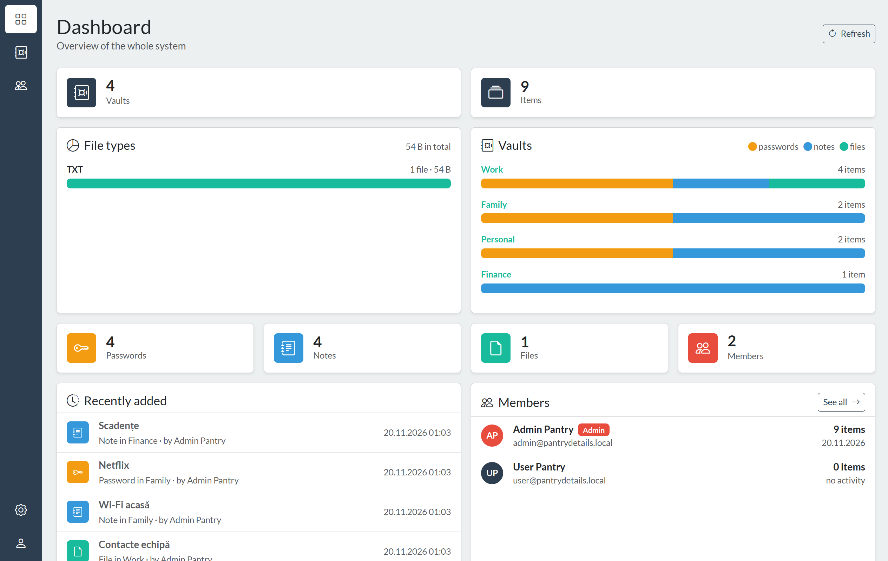
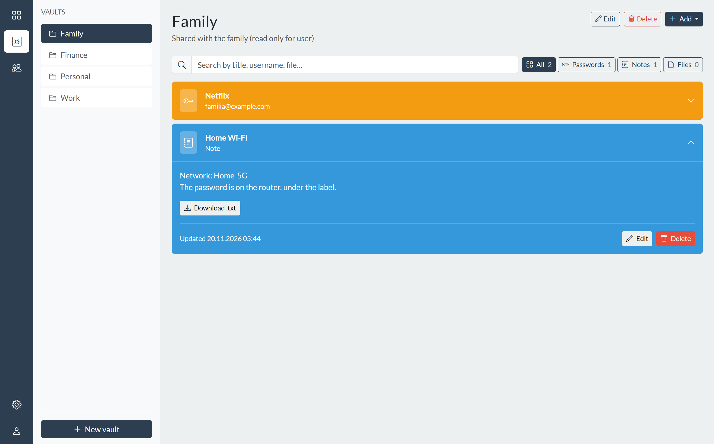
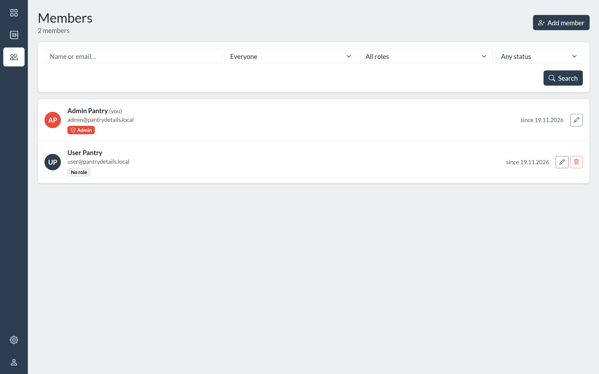
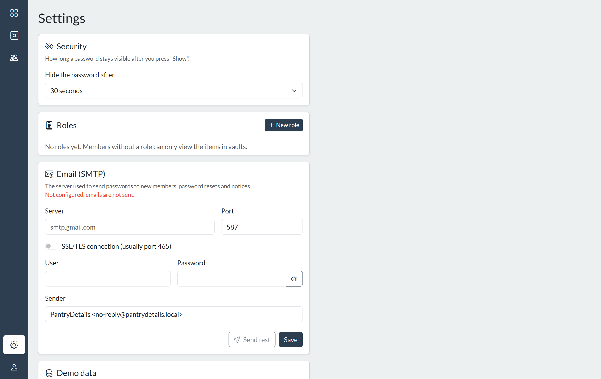
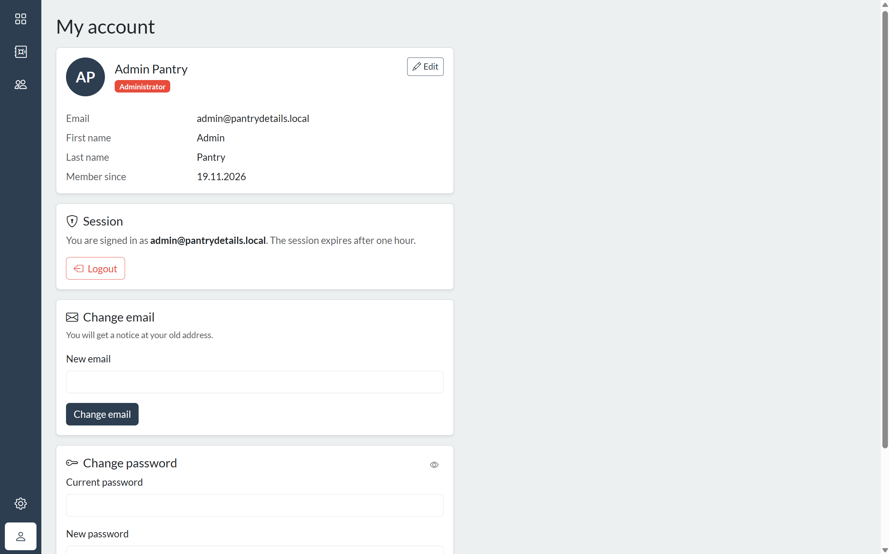

# PantryDetails

PantryDetails is a lightweight web application designed to help people store important details in one single app.

Over the years, we stored our clients' accounts in Google Drive or even in one cloud Microsoft Word file. Sometimes we forgot to add the credentials to the file and kept calling the client to ask for them. So I thought about building a light, in-house solution that could help us with it. That's how PantryDetails was born.

## Features

- **Vaults** – group passwords, notes and files in one place
- **Encryption** – passwords and notes are encrypted with AES-256-GCM
- **Roles and permissions** – decide who can view, add, edit or delete in each vault
- **Members** – invite people, and they receive a temporary password by email
- **Dashboard** – quick stats, file types, vault sizes and recently added items
- **Settings** – security rules, roles and SMTP configuration
- **Demo data** – import sample vaults with one click and delete them when you are done
- **Responsive** – works on desktop and mobile

## 🛠 Tech stack

TypeScript, Node.js, Express, TypeORM, Angular, Bootstrap, MySQL, Docker, Postman, Swagger UI

## Screenshots

<table>
  <tr>
    <td align="center">
      <a href="screenshots/dashboard.png"></a><br>
      <sub><b>Dashboard</b></sub>
    </td>
    <td align="center">
      <a href="screenshots/vaults.png"></a><br>
      <sub><b>Vaults</b></sub>
    </td>
    <td align="center">
      <a href="screenshots/members.png"></a><br>
      <sub><b>Members</b></sub>
    </td>
  </tr>
  <tr>
    <td align="center">
      <a href="screenshots/settings.png"></a><br>
      <sub><b>Settings</b></sub>
    </td>
    <td align="center">
      <a href="screenshots/my-account.png"></a><br>
      <sub><b>My account</b></sub>
    </td>
    <td></td>
  </tr>
</table>

<sub>Click a thumbnail to see it full size.</sub>

## Run Locally

Clone the project

```bash
git clone https://github.com/constantinrazvan/PantryDetails.git
cd PantryDetails
```

### Backend

You need Node.js and a MySQL server (for example XAMPP).

```bash
cd backend
npm install
cp .env.example .env
```

Fill in the database details and secrets in `.env`:

```env
NODE_ENV = "development"
PORT = 3000

DB_HOST = "localhost"
DB_PORT = 3306
DB_USER = "root"
DB_PASSWORD = ""
DB_NAME = "pantry_details"

JWT_SECRET = ""
JWT_AUDIENCE = "frontend-pantrydetails"
JWT_ISSUER = "backend-pantrydetails"

ENCRYPTION_KEY = ""

STORAGE_PATH = "./storage"
MAX_UPLOAD_MB = 25

FRONTEND_URL = "http://localhost:4200"
CORS_ORIGINS = "http://localhost:4200"
```

| Variable         | Description                                                  |
| ---------------- | ------------------------------------------------------------ |
| `NODE_ENV`       | `development` or `production`                                |
| `PORT`           | Port for the API                                             |
| `DB_*`           | MySQL connection details                                     |
| `JWT_SECRET`     | Any long random string used to sign login tokens             |
| `JWT_AUDIENCE`   | Token audience (keep the default)                            |
| `JWT_ISSUER`     | Token issuer (keep the default)                              |
| `ENCRYPTION_KEY` | 32 bytes in base64, used to encrypt passwords and notes      |
| `STORAGE_PATH`   | Folder where uploaded files are saved                        |
| `MAX_UPLOAD_MB`  | Maximum upload size in MB                                    |
| `FRONTEND_URL`   | Frontend address, used in emails                             |
| `CORS_ORIGINS`   | Allowed frontend origins, separated by commas                |

Generate the secrets with:

```bash
node -e "console.log(require('crypto').randomBytes(48).toString('hex'))"     # JWT_SECRET
node -e "console.log(require('crypto').randomBytes(32).toString('base64'))"  # ENCRYPTION_KEY
```

> Keep `ENCRYPTION_KEY` safe. If you change it, the saved passwords and notes can no longer be decrypted.

Then create the demo users and start the server:

```bash
npm run seed
npm run dev
```

The API runs on http://localhost:3000.

### Frontend

```bash
cd frontend
npm install
npm start
```

Open http://localhost:4200.

### Or with Docker

```bash
cp backend/.env.example backend/.env
docker compose up --build
```

Open http://localhost:8080.

## API docs

### Swagger

With the backend running, open http://localhost:3000/api/docs (or http://localhost:8080/api/docs with Docker).

Call **POST /auth/login**, copy the `token` from the response, press **Authorize** and paste it. Now you can try every endpoint from the browser.

### Postman

Import [backend/postman/PantryDetails.postman_collection.json](backend/postman/PantryDetails.postman_collection.json) in Postman. Run **Auth → Login (admin)** first: the token is saved automatically and used by all the other requests. Change `folderId`, `itemId`, `userId` and `roleId` in the collection variables when you need them.

## Demo accounts

| Role  | Email                     | Password     |
| ----- | ------------------------- | ------------ |
| Admin | admin@pantrydetails.local | Admin1234!   |
| User  | user@pantrydetails.local  | User1234!    |

### How to start

1. The first time, sign in with the demo admin account: `admin@pantrydetails.local` / `Admin1234!`.
2. Go to **Settings → Demo data** to import the sample vaults, or delete them when you are done.
3. Deleting the demo data removes the demo vaults and the demo user. The **admin account stays**, so you can still sign in.
4. Go to **Members** and add your own account with **Admin** access.
5. Sign in with your new account and delete the demo admin from **Members**.

> The app always keeps at least one admin. You cannot delete the last admin, and you cannot delete your own account.
